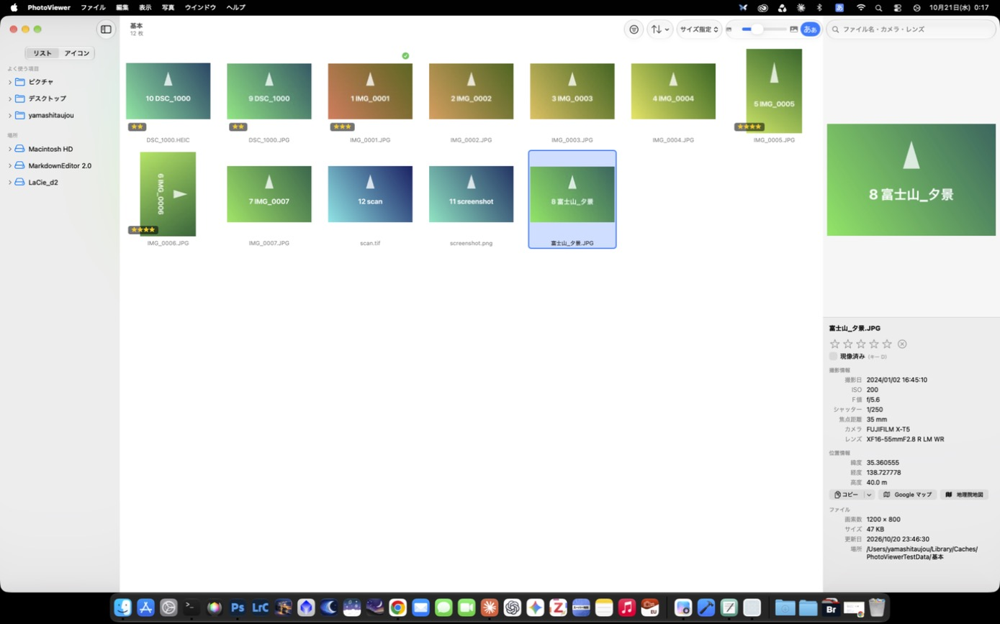

# PhotoViewer

Adobe Bridge の代わりに使う、軽量な macOS 用の写真閲覧アプリ（SwiftUI）。



## インストール
1. [リリース](https://github.com/Geology-cat/PhotoViewer/releases) から最新の `PhotoViewer-<バージョン>.dmg`（現在は 1.1.3）をダウンロードして開く
2. DMG の中の「かんたんインストーラ.scpt」をダブルクリック → スクリプトエディタの ▶︎（実行）を押す
   - 「アプリケーション」フォルダへのコピー、Gatekeeper の制限の解除（隔離属性の削除）、初回起動までを自動で行う
   - 手動で入れる場合は、PhotoViewer.app を Applications へドラッグし、`xattr -dr com.apple.quarantine /Applications/PhotoViewer.app` を実行する

## できること
- フォルダツリー（リスト／アイコン表示）とサムネイルグリッド（サイズ指定／列数指定）。リスト表示ではダブルクリックでフォルダに入り、そこから下だけを表示できる（Finder のリスト表示と同じ）
- 右列（プレビュー＋情報）は境界をドラッグして広げられる（グリッドは 1 列分まで狭くできる）
- Finder と同じ「戻る」「進む」（⌘[ ／ ⌘]）。フォルダの追加・削除はサイドバーにすぐ反映される
- プレビューを左右に 90° 回転（表示だけ。ファイルは書き換えない）
- プレビューをクリックで拡大し、ドラッグで動かせる（もう一度クリックで全体表示。拡大率は環境設定で 50〜400%）
- 動画（MOV・MP4 など）：サムネイル、プレビューでの再生、長さ・解像度・撮影日・カメラ・位置情報
- 大きな TIF（Photoshop のレイヤー入りなど）も、必要な部分だけを読んで素早く表示。時間のかかった画像は縮小版をディスクに保存して 2 回目以降はすぐに表示
- ドライブは内蔵・外付け・ディスクイメージ・ネットワークに分けて表示（外付けはオレンジ）。空き容量と取り出しボタンつき
- プレビューと撮影情報（撮影日・ISO・F 値・シャッタースピード・焦点距離・カメラ・レンズ）
- GPS：緯度経度のコピー、Google マップ・地理院地図で開く
- レーティング（★1〜5・リジェクト）と「現像済み」チェック。XMP サイドカーに保存する（RAW は Bridge でも同じ★が見えることを確認済み）
- 検索・絞り込み：ファイル名・カメラ・レンズのフリーワード、拡張子、レーティング、現像済み、撮影日・カメラ・レンズ・ISO・F 値・SS・焦点距離の範囲、位置情報の有無
- 並べ替え：ファイル名・種類（RAW → JPEG → HEIC → TIF → PNG → その他 → 動画）・撮影日・更新日・レーティング・サイズ
- 拡張子ごとに、ダブルクリックで開くアプリを環境設定で指定
- ファイル名の一括変更（連番・撮影日時など。RAW＋JPEG ペアとサイドカーも一緒に変更し、⌘Z で取り消せる）
- Quick Look（Space）、ゴミ箱へ（⌘⌫、⌘Z で戻せる）、フォルダの変更の自動反映

## キー操作
| キー | 動作 |
|------|------|
| 矢印キー | 選択の移動（⇧ で範囲選択）。←→ は行の端で前後の行へ回り込む |
| Return／ダブルクリック／⌘O | 指定のアプリで開く |
| Space | Quick Look |
| 0〜5 | レーティング（⌘0〜⌘5 でも可） |
| ⌥⌫ | リジェクト |
| D（⇧⌘D） | 現像済みの切り替え |
| ⇧⌘R | 名前の一括変更 |
| ⌘⌫ | ゴミ箱に入れる |
| ⌘Z | 一括変更・ゴミ箱の取り消し |
| ⌘R | 再読み込み |
| ⇧⌘O | フォルダを開く |
| ⌃⌘S／⌃⌘I | サイドバー／右列の開閉 |
| ⌘↑ | サイドバー（リスト表示）で上の階層へ |
| ⌘[ ／ ⌘] | 戻る／進む |
| ⌥⌘← ／ ⌥⌘→ | プレビューを左／右に 90° 回転 |
| ⌘, | 環境設定 |

## レガシー版（macOS 10.12 向け）

macOS 10.12 Sierra でも使える「PhotoViewer Legacy」を `Legacy/` で開発しています（機能は通常版と同じ。HEIC・HEVC 動画・CR3 など、10.12 の OS が読めない形式は表示できません）。

## ビルド
```bash
brew install xcodegen
./Scripts/build_dist.sh
open dist/PhotoViewer.app
```
署名には Xcode に登録した Apple ID（Personal Team）を使う（`project.yml` の `DEVELOPMENT_TEAM`）。

詳しくは `開発計画書.md`、`開発履歴.md`、`CLAUDE.md` を参照。
